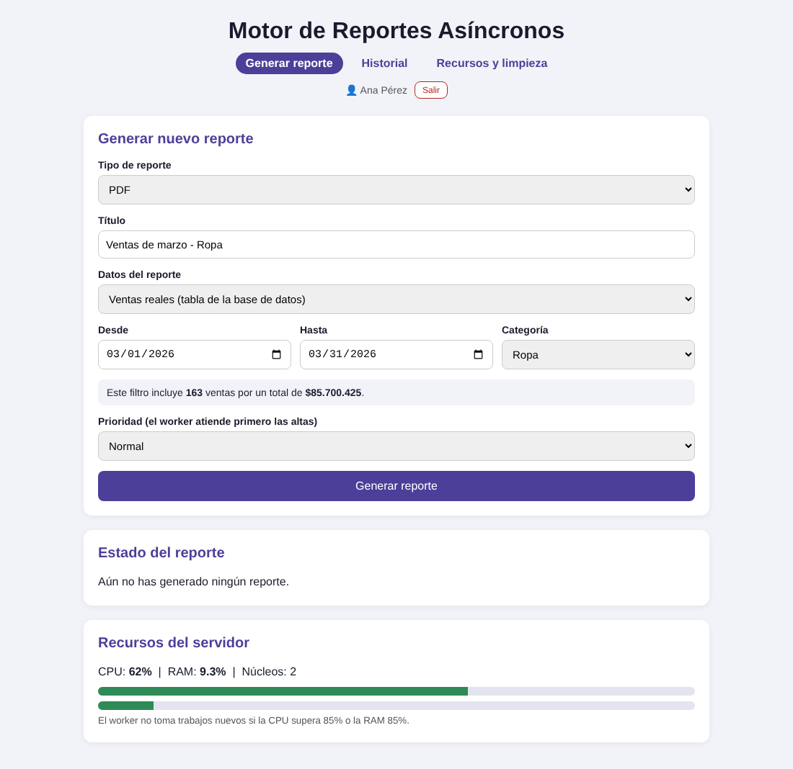
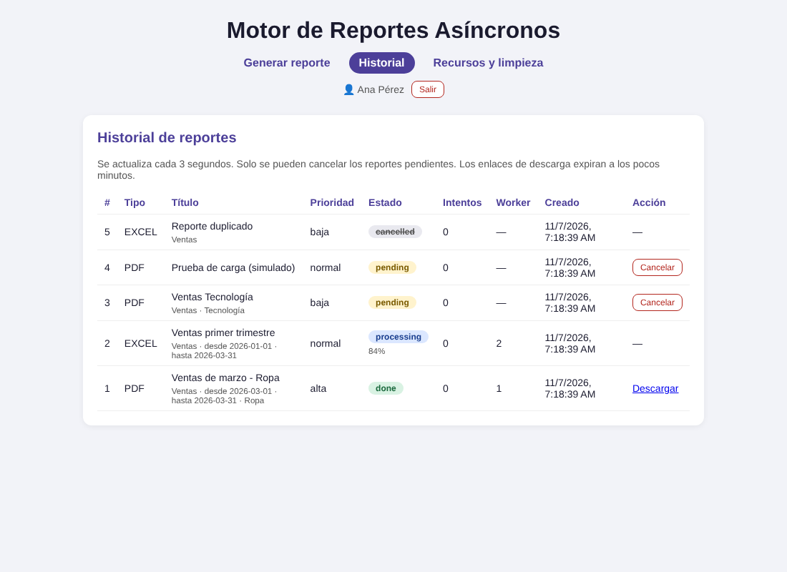
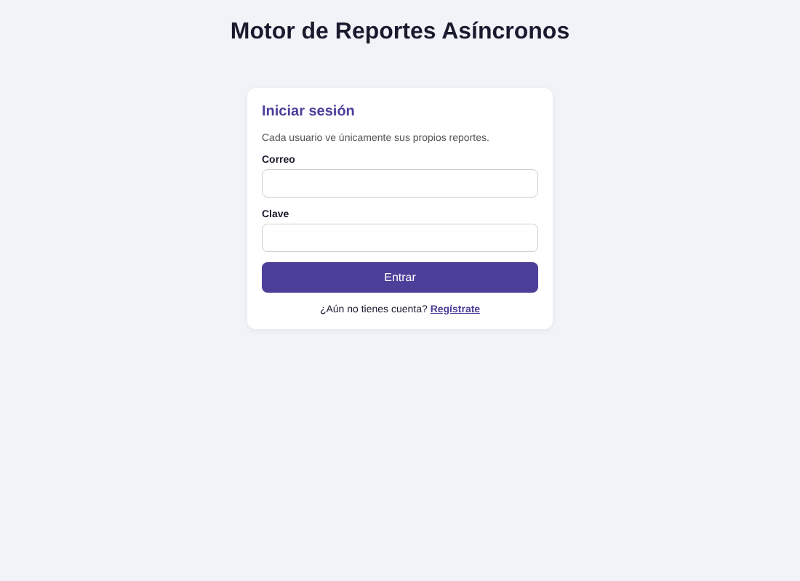
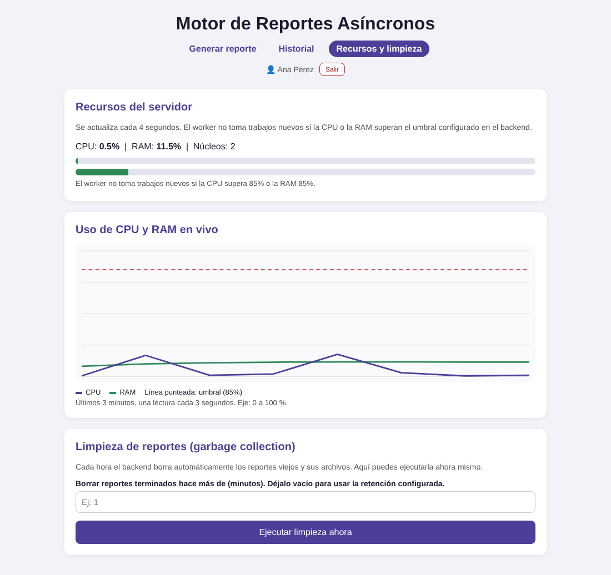
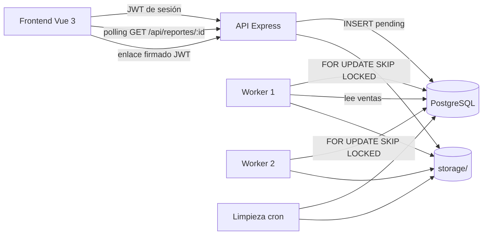

# Motor de Reportes Asíncronos con Control de Recursos

Sistema que genera reportes **PDF y Excel** en segundo plano. El API solo encola el
pedido; uno o varios **workers** (procesos aparte) lo generan sin bloquear al usuario,
vigilando el uso de **CPU y RAM** del servidor. Cada usuario inicia sesión (**JWT**), ve
solo sus reportes y descarga los archivos con **enlaces temporales firmados**. Una
**recolección de basura** borra los reportes viejos y sus archivos.

| Generar con filtros de ventas | Historial con dos workers |
|---|---|
|  |  |

| Inicio de sesión | Recursos en vivo |
|---|---|
|  |  |

## Arquitectura



- La **cola** es la propia tabla `jobs` de PostgreSQL (estados `pending → processing → done / failed / cancelled`).
- Dos workers nunca toman el mismo reporte gracias a `FOR UPDATE SKIP LOCKED`.
- Antes de tomar trabajo, el worker revisa CPU/RAM; si superan el umbral, espera.

## Estructura del proyecto

```
motor-reportes/
├── backend/    API + worker (config / controllers / models / routes / services / workers / middlewares / tests)
├── frontend/   Vue 3 + Vite (views / components / layouts / router / services / store)
├── docs/       capturas de pantalla
└── docker-compose.yml   (opcional) levanta base, API y dos workers
```

## 1. Base de datos

1. Instala PostgreSQL y abre DBeaver (o psql).
2. Crea una base de datos llamada `reportes_db`.

## 2. Backend

```bash
cd backend
npm install
cp .env.example .env     # edita DB_PASSWORD y pon un JWT_SECRET propio
npm run migrate          # crea las tablas: jobs, usuarios, ventas
npm run seed             # llena "ventas" con 5000 ventas de ejemplo (ene–oct 2026)
```

Cada proceso va en **su propia terminal**, dentro de `backend`:

```bash
npm run dev              # API en http://localhost:4000  (Swagger: /api/docs)
npm run worker -- 1      # worker 1
npm run worker -- 2      # worker 2 (opcional, para ver el reparto)
```

## 3. Frontend

```bash
cd frontend
npm install
npm run dev              # http://localhost:5173
```

Si tu API usa otro puerto, copia `.env.example` a `.env` y cambia `VITE_API_URL`.

## 4. Cómo se usa

1. Entra a `http://localhost:5173` y **crea una cuenta** (o inicia sesión).
2. En **Generar reporte** elige PDF o Excel y de dónde salen los datos:
   - **Ventas reales**: filtra por fecha (desde/hasta) y categoría. El formulario muestra
     cuántas ventas y qué total tendrá el reporte antes de generarlo.
   - **Datos simulados**: filas inventadas, útiles para probar el peso de un reporte.
3. Elige la prioridad (alta, normal, baja) y pulsa **Generar reporte**.
4. Mira el avance (barra de progreso) y descarga el archivo cuando termine.
5. En **Historial** ves tus reportes, el worker que procesó cada uno, y puedes cancelar los pendientes.
6. En **Recursos y limpieza** ves CPU/RAM en vivo y puedes ejecutar la limpieza manualmente.

## 5. Funciones

| Función | Detalle |
|---|---|
| Cola desacoplada | El API encola; el worker (otro proceso) genera el archivo |
| Varios workers | `npm run worker -- 1`, `-- 2`… comparten la cola sin duplicar trabajo |
| Control de recursos | CPU real (`os.cpus()`) y RAM; el worker se pausa sobre `UMBRAL_CPU` / `UMBRAL_RAM` |
| Progreso | Se genera por lotes de 250 filas y se guarda el % en la base |
| Reintentos | Un fallo vuelve a `pending` hasta `MAX_INTENTOS`; luego queda `failed` |
| Prioridades | `alta` se atiende antes que `normal` y `baja` |
| Cancelar | Solo reportes `pending` (si ya está en proceso responde 409) |
| Login con JWT | Registro e inicio de sesión; clave guardada con **hash bcrypt** |
| Aislamiento | Cada usuario solo ve, consulta y cancela **sus** reportes (los ajenos dan 404) |
| Datos reales | Reportes de la tabla `ventas` con filtros por fecha y categoría |
| Descarga segura | Enlace con token firmado que expira (`MINUTOS_LINK`); un token de sesión no sirve como enlace |
| Rate limiting | Crear reportes: `RATE_LIMIT_MAX` por minuto y por IP. Login/registro: `RATE_LIMIT_AUTH_MAX` |
| Recolección de basura | Cron cada hora + botón manual; borra registros y archivos viejos |
| Salud | `GET /api/salud` comprueba API y base de datos |
| Pruebas | `npm test` (Jest + Supertest, sin necesitar PostgreSQL) |

## 6. API

La documentación interactiva está en `http://localhost:4000/api/docs`. Para probar rutas
protegidas: haz `POST /api/auth/login`, copia el `token` y pulsa **Authorize**.

| Método | Ruta | Descripción |
|---|---|---|
| POST | `/api/auth/registro` | Crea cuenta y devuelve token |
| POST | `/api/auth/login` | Inicia sesión y devuelve token |
| GET | `/api/auth/yo` | Usuario de la sesión |
| POST | `/api/reportes` | Encola un reporte (`fuente`: `simulado` o `ventas`, con `filtros`) |
| GET | `/api/reportes` | Historial de **tus** reportes |
| GET | `/api/reportes/:id` | Estado de un reporte tuyo |
| POST | `/api/reportes/:id/cancelar` | Cancela uno pendiente |
| GET | `/api/reportes/:id/descargar?token=…` | Descarga con enlace firmado |
| GET | `/api/ventas/categorias` | Categorías para el filtro |
| GET | `/api/ventas/resumen` | Filas y total de un filtro |
| GET | `/api/recursos` · `/api/recursos/historial` | CPU/RAM actual e historial |
| POST | `/api/mantenimiento/limpieza` | Ejecuta la limpieza ahora |
| GET | `/api/salud` | Estado del API y la base |

## 7. Pruebas

```bash
cd backend
npm test
```

Cubren validaciones, prioridades, cancelar (200/404/409), reportes de ventas (fechas
inválidas, filtros), registro y login (clave con hash, mismo mensaje de error), rutas
protegidas (401), enlaces firmados (expirado, manipulado, token de sesión vs. descarga)
y rate limiting (429).

## 8. Docker Compose (opcional)

Con Docker Desktop instalado:

```bash
docker compose up --build
```

Levanta PostgreSQL, ejecuta la migración y el seed, y arranca el API
(`http://localhost:4000/api/docs`) y dos workers. El frontend se sigue corriendo con
`npm run dev` dentro de `frontend`.

## 9. Variables de entorno (`backend/.env`)

| Variable | Para qué sirve |
|---|---|
| `PORT` | Puerto del API (4000) |
| `DB_HOST`, `DB_PORT`, `DB_NAME`, `DB_USER`, `DB_PASSWORD` | Conexión a PostgreSQL |
| `JWT_SECRET` | Clave para firmar tokens de sesión y enlaces de descarga. **Cámbiala y no la compartas** |
| `HORAS_SESION` | Duración de la sesión (8 por defecto) |
| `UMBRAL_CPU`, `UMBRAL_RAM` | Porcentaje desde el cual el worker se pausa |
| `MINUTOS_LINK` | Vida de un enlace de descarga |
| `HORAS_RETENCION` / `MINUTOS_RETENCION` | Cuánto se conservan los reportes terminados |
| `MAX_INTENTOS` | Reintentos antes de marcar un reporte como fallido |
| `RATE_LIMIT_MAX`, `RATE_LIMIT_AUTH_MAX`, `RATE_LIMIT_VENTANA_SEG` | Límite de peticiones por IP |
| `RETARDO_LOTE_MS` | (Demo) retraso por lote para ver avanzar la barra de progreso |

## 10. Subir a GitHub

```bash
git add .
git commit -m "Descripción del cambio"
git push
```

`.env`, `node_modules/` y `backend/storage/*` están en `.gitignore`: las claves reales
y los archivos generados no se suben. Si alguna vez subes una clave por error, cámbiala
(borrar el archivo después no la quita del historial).

## 11. Notas

- **Actualizar una base de datos anterior:** ejecuta `npm run migrate` (agrega las tablas y
  columnas nuevas sin borrar nada) y luego `npm run seed`.
- Los reportes creados antes del login no tienen dueño, por lo que ya no aparecen en ningún historial.
- El límite de peticiones y el historial de CPU/RAM viven en la memoria del proceso del API: se
  reinician al reiniciarlo.

## 12. Ideas a futuro

- Roles (administrador que vea todos los reportes y la limpieza global).
- Gráficas y totales por categoría dentro del propio reporte.
- Notificación al terminar un reporte (en lugar de polling).
